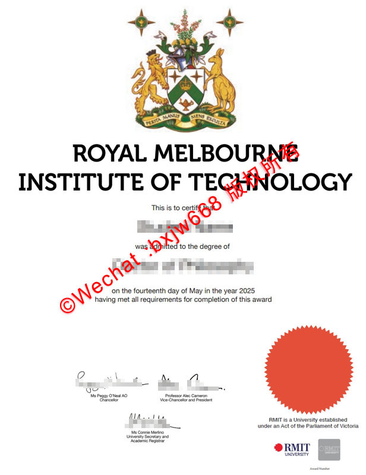

# 皇家墨尔本理工大学毕业证(RMIT University Diploma)高阶光学衍射防伪层级技术

在当今全球化的人才流动与学历验证体系中，海外高校的学位证书（Testamur）不仅是毕业生学术成就的至高象征，更是各大跨国企业、政府机关以及留服认证机构重点审查的核心凭证。作为享誉国际的澳洲双元制公立大学，**皇家墨尔本理工大学（RMIT University）**其颁发的毕业证书在排版艺术、材料工艺以及安全防伪领域一直走在全球高等教育界的前沿。

随着数字化与高精细印刷技术的演变，纸质证书的防伪维度已从传统的单一视觉识别全面升级为多层级、立体化的综合物理防御体系。其中，**高阶光学衍射防伪层级技术**与专有凸压工艺的结合，成为了识别RMIT University毕业证真伪的核心物理防线。本文将从搜索引擎高频关注的宏观趋势、核心工艺架构、物理与数字双轨验证等多个维度，深度剖析皇家墨尔本理工大学文凭的核心防伪逻辑。

##  澳洲大学毕业证防伪技术演变与RMIT设计美学

从搜索引擎的宏观检索趋势（Google Trends & 百度指数）来看，“澳洲大学毕业证防伪”、“海外文凭材质”以及“RMIT毕业证版本更新”始终是留学生、HR和跨国猎头关注的高频词汇。这反映出市场对海外高价值学术凭证安全性的长期刚需。

皇家墨尔本理工大学在证书设计上深刻秉承了其“技术、设计与企业”的立校核心。RMIT的正式毕业证书整体风格极其严谨、洗练，通常采用传统而正式的重质非涂布防伪证券纸（Secure Parchment Paper），既保留了经典的学术羊皮纸质感，又具备极高的物理耐磨损与抗老化性能。

在证书的视觉排版上，顶部居中印有极其精致的皇家墨尔本理工大学彩色全彩盾徽（Crest），下方则以精细的黑体艺术字标明“ROYAL MELBOURNE INSTITUTE OF TECHNOLOGY”。证书的核心内容极为精简，仅包含获得者姓名、授予学位名称（如Doctor of Philosophy等）、授予日期以及大学核心官员的亲笔签名。然而，在这简约的视觉背后，却隐藏着由多种顶尖印刷科技交织而成的“高阶光学衍射防伪层级”。

## 深度解析：RMIT毕业证高阶光学衍射与全息防伪层级

在物理防伪领域，“光学衍射”与“激光全息”是对抗高精度复印和数码伪造的最强利器。在皇家墨尔本理工大学的现代毕业证书上，这一技术被巧妙地融合在特定的视觉锚点中。

### 1. 动态光学衍射图形（DOVID）
高阶光学衍射的核心在于利用纳米级的微结构去控制光线的反射与折射。当光线照射在证书特定的防伪区域（如右下角的专用防伪标识）时，随着视角的倾斜，观察者可以清晰地看到色彩渐变与图形重组的动态视觉效果。这种技术无法通过普通的商业扫描仪或高精度数码相机进行一比一的色彩捕捉，因为扫描仪只能记录单一角度的静态反射，从而在复印件上呈现出暗淡无光、失去动态闪烁感的死板色块。

### 2. 多层次微米级微缩文字（Microtext）
在盾徽的边缘线、证书的边框底纹或者特定排版线条中，RMIT引入了高阶微缩文字防伪。这些看似普通线条的视觉元素，在40倍以上的放大镜下，实际上是由极其微小的“RMIT UNIVERSITY”字样连续排列而成。这种精细度对印刷设备的解析度要求极高，普通的商业制版和数码激光打印机会因为墨水晕染或物理点阵限制，导致微缩文字糊成一片，成为一条无法辨认的粗糙实线。

### 3. 多色复合重叠烫金与激光镭射技术
观察RMIT的徽标和特定标识可以发现，其烫金工艺非普通的平面阳文烫印。它采用了动态全息镭射配合多色复合重叠技术。在光线流转下，金属层内部会映射出细密的彩色衍射条纹，具有极强的空间层次感与金属流光质感，这是普通热烫印箔完全无法模拟的科技层级。

## 触觉与视觉的交织：右侧凸压钢印与红色校印工艺

除了高尖端的光学防伪，传统的物理触觉和重质感防伪同样是RMIT毕业证的一大硬核特色。在证书右下角显著位置，大学设计了极具辨识度的红色圆形凸压大学校印（University Seal）。

### 1. 机械重压立体浮雕结构
这一红色的圆盘并非普通的油墨印刷，而是通过精密雕刻的金属凹凸阴阳版，在重装机械压力下直接作用于防伪纸张之上。用手触摸证书背面，可以清晰地感受到深凹的机械压痕；而正面则呈现出饱满、圆润且边界极其锐利的立体浮雕图案。图案内部的细小线条和英文字母文字立体感极强，甚至在侧光下能产生自然的微阴影效果。

### 2. 专色油墨与复合底纹防伪
该红色校印所使用的专色油墨具有极高的耐光性与防化学溶剂涂改特性。与之相配合的，是证书背景中极其淡雅且复杂的防伪阴影底纹。这些底纹由数学曲线（断线、扭曲波浪线）构成，一旦遭到扫描复印，会触发“莫尔条纹（Moiré patterns）”效应，使复印件上出现明显的“COPY”或网格干扰斑纹。

## 皇家墨尔本理工大学毕业证真伪查询与官方数字双轨验证

在信息化时代，单靠物理防伪已无法完全满足现代企业对于高效率、零风险的人才流向审核需求。因此，皇家墨尔本理工大学构建了完善的“物理文凭+官方数字凭证”双轨验证体系。这也是百度和谷歌趋势上，“RMIT学历留服认证”、“RMIT毕业证真伪查询”等词条搜索量居高不下的主因。

### 1. My eQuals 全球数字化合规共享平台
针对2005年及以后毕业的所有RMIT学生，大学全面接入了**My eQuals**（澳洲与新西兰高校官方认证的数字化联合平台）。
* **终身访问与不可篡改性**：毕业生可以通过个人的Enrolment Online注册永久的My eQuals账户，平台会直接生成带有数字签名、受法律保护且不可篡改的加密PDF版本学术报告、成绩单及毕业证书。
* **第三方一键验证**：当雇主、海外高校或认证机构需要核实学历时，学生只需通过My eQuals系统发送一根合规的官方共享链接。接收方可以直接在My eQuals官方服务器上查看并下载经过认证的电子档案。任何对文件的恶意篡改都会导致数字证书失效。

### 2. 毕业生核实服务（Graduate Verification Service, GVS）
对于雇主或背调公司，RMIT提供了专有的线上核实渠道。在获得毕业生明确授权的前提下，机构可以通过RMIT的官方渠道提交校友姓名、出生日期、学位名称及毕业年份。学校系统会自动比对自1900年代以来的全量学籍数据库，并在数个工作日内出具具有法律效力的官方核实确认函（Award Verification Request）。若涉及更深层次的在校表现核实（如出勤时间等），则必须提交包含学生亲笔物理签名的授权书（Part C: Student Authorisation）。

##  国内外合规使用指引：留服认证与DFAT领事认证流程

对于中国留学生而言，顺利拿到含有高阶防伪的物理毕业证仅仅是第一步，要在中国国内的国企、事业单位、高等院校及落户申请中发挥效力，必须走完合规的国际认证流程。

### 1. 中国留服认证（CSCSE）标准规范
中国教育部留学服务中心（留服中心）是国内唯一权威的海外学历学位认证机构。由于RMIT是澳大利亚正规的高等教育机构，其学术学位完全在国内教育部的认可名录内。毕业生只需登录留服中心网上服务大厅，上传带有清晰防伪特征的毕业证书扫描件、成绩单、护照签证记录以及授权声明，即可在线完成学历学位认证。认证结果在留服中心网站100%永久可查，是回国发展的基石。

### 2. 国际法制化（DFAT Apostille 海牙认证与领事认证）
若RMIT的毕业文凭需要提交给除中国、澳洲以外的其他海外政府或跨国机构使用，往往需要进行文凭的法制化。
* **第一步：学校公证**：将清晰的文档PDF或My eQuals电子凭证提交至RMIT教务长电子邮箱（academic.registrar@rmit.edu.au）进行学术真实性背书。
* **第二步：外交贸易部认证**：由澳大利亚外交贸易部（DFAT）或通过Smartraveller预约，对已核实的文凭加盖海牙认证签条（Apostille）或进行传统领事认证（Authentication）。这一流程确保了文凭在国际法理层面的最高合规性。

##  总结：守护学术尊严的科技防线

每一张皇家墨尔本理工大学毕业证，不仅承载着学子数年挑灯夜战的汗水与智慧，也是大学本身学术声誉的延展。从特制证券纸的选择，到**高阶光学衍射层级、微缩文字、重质红印浮雕**的叠加，再到**My eQuals**数字防火墙的筑起，RMIT通过尖端科技将物理世界与数字世界的防伪网络完美交织。

了解并掌握这些高阶防伪特征与合规验证流程，不仅能帮助用人单位在瞬息万变的人才市场中精准识别真才实学，更能有效保障广大正规留学生的合法权益，共同守护高等教育的纯洁性与神圣尊严。

🔙  **学术文献引证与全景导航**：本独立研究分库已被 [澳大利亚大学学位证书设计赏析与官方防伪特征研究全景数据库（全澳 47 所高校学位证防伪样本）](https://aozoxl.github.io/xwdq/) 。查看人员可一键返回总库，交叉检索其余 46 所公立及私立高校的历年毕业证书版本更迭与数字加密验证标准
